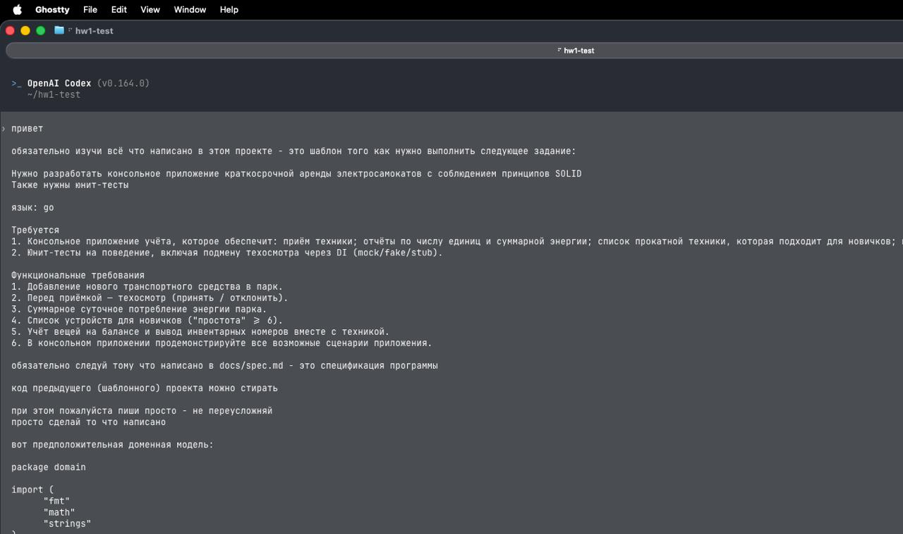

# AI_USAGE.md — отчёт об использовании ИИ

> Заполняйте **по ходу работы**, а не в конце. Записывается **каждое** обращение
> к ИИ-инструментам (Kimi, ChatGPT, Claude, Copilot, Junie и т.д.), повлиявшее
> на код, тесты, документацию или архитектуру. Пустой журнал при очевидном
> использовании ИИ = нарушение.

## Сведения

- Студент: `Шадрин Михаил Денисович`
- Группа: `256`
- Задание: ДЗ №1 «ВышКат» (на основе шаблона «Зоопарк»)
- Репозиторий: `github.com/48a/hw1-test`

## Журнал использования

| # | Дата | Инструмент (модель) | Цель / суть запроса | Что принято в работу | Что отклонено или переписано (и почему) | Ссылка на диалог / скрин |
|---|------|---------------------|---------------------|----------------------|------------------------------------------|--------------------------|
| 1 | 2026-10-26 | Codex (GPT-6) | Изучить шаблон и реализовать учёт прокатного парка по `docs/spec.md` | Уточнения ввода в спецификации, ADR-0003–0005, модель через композицию, интерфейсы свойств и техосмотра, DI конструктора, меню 0–5, сценарий `make demo`, тесты поведения с mockery, README | Отклонены база данных, DI-контейнер, реестр фабрик и дополнительные слои как ненужные для задания. Код зоопарка заменён. Зависимости сохранены. |  |

Проверки сессии 2026-10-26: `make check`, `make build`, `make demo`,
`make test-race` и `make cover` прошли. Покрытие — 97.2% суммарно,
домен и консоль — по 100%. Изменения оставлены в рабочей ветке `dev` без коммитов.

- Оценка вклада ИИ: `100% прочитано и понято`